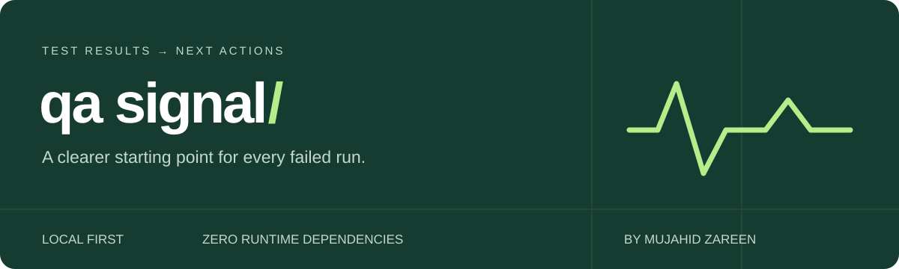

# QA Signal

**Turn Playwright test results into a focused investigation queue.**

A small, local QA tool by Mujahid Zareen. It compares two runs, keeps retry evidence, groups similar error messages, and prepares investigation drafts you can refine into bug tickets.



## The gap it addresses

After an automated run, a QA engineer still has to answer: *What changed? What keeps failing? Is this a flaky test? What evidence should go into a ticket?*

QA Signal puts those answers together in a lightweight handoff. It complements Playwright's built-in HTML report; the original report and trace remain the best places to debug browser behavior. This project does not claim to replace full test-management or commercial analytics platforms.

## What works

- Compare a current JSON report with a baseline: regressions, recurring issues, recovered tests, newly observed tests, and tests missing from the current run.
- Preserve failed retry errors even when a later retry passes.
- Distinguish normal passes, expected failures, unexpected passes, skipped tests, interrupted tests, and tests without execution evidence.
- Group similar error messages without merging different HTTP status codes or assertion values.
- Suggest an investigation area: locator ambiguity, runtime exception, network, browser/runner, assertion mismatch, timeout, or unknown.
- Export a searchable HTML report, Markdown summary, investigation drafts, and structured JSON.
- Optional CI exit policies; common credential masking; no runtime packages, accounts, telemetry, or outbound requests.

**Categories are hypotheses. The tool cannot prove whether a failure belongs to the app, test code, data, or environment.**

## Try the included demo

Requires **Node.js 22 or later**. No `npm install` is needed.

1. Download this repository using **Code → Download ZIP**, then extract it.
2. Open a terminal in the extracted folder.
3. Run:

```sh
npm test
npm run demo
```

Open `demo-report/index.html` in your browser. A pre-generated demo is included, so it is also possible to open that file immediately after downloading. All demo results are explicitly fictional.

## Use your own Playwright results

In your existing `playwright.config.js` or `.ts`, add the JSON reporter alongside your other reporters:

```js
reporter: [
  ['list'],
  ['html', { open: 'never' }],
  ['json', { outputFile: 'results.json' }],
],
```

Run your tests normally:

```sh
npx playwright test
```

Then, from the QA Signal folder:

```sh
node bin/qa-signal.js "C:/path/to/your-tests/results.json" --out my-report
```

For a baseline comparison:

```sh
node bin/qa-signal.js current.json --baseline previous.json --out my-report --label "Regression run"
```

These commands also work in Windows PowerShell; replace paths with your actual files. On macOS/Linux, use paths such as `/home/me/tests/results.json`. Keep a copy of the previous JSON **before** running Playwright again because Playwright writes the current report to the configured output file.

Open `my-report/index.html`. Keep its companion files in the same folder for the download links to work.

### Command-line options

| Option | Purpose |
| --- | --- |
| `--baseline file.json` | Compare against a previous run |
| `--out folder` | Output directory; default `qa-signal-report` |
| `--label "Run name"` | Label displayed in all reports |
| `--fail-on none` | Default: generating a report does not fail the command |
| `--fail-on failures` | Exit 1 for unexpected failures, unexpected passes, or incomplete runs |
| `--fail-on unstable` | Same as above, plus flaky outcomes |
| `--fail-on new` | Requires a baseline; exit 1 for adverse new/regressed/unverified results or incomplete runs |
| `--force` | Replace existing generated files in the output directory |
| `--help` | Show usage |

Exit code **0** means report generation succeeded and the selected policy did not fail. It does **not** mean all tests passed. Exit **1** means the policy failed, with reports still written. Exit **2** means invalid input or an output error.

### Output files

| File | Use |
| --- | --- |
| `index.html` | Offline report with search, filters, retry history, and evidence references |
| `summary.md` | QA status handoff |
| `bug-drafts.md` | Investigation drafts for manual review before ticket creation |
| `report.json` | Normalized results for your own integrations |

## Comparison rules

Tests match by file path, complete nested title, and project name. Source line changes do not break the match. Use baseline and current reports from the same project layout and environment; matching cannot prove that two runs are comparable.

| Change | Meaning |
| --- | --- |
| `regression` | Previously passed; now failed, flaky, interrupted, or unexpectedly passed |
| `recurring` | Adverse in both runs; the specific error may have changed |
| `recovered` | Previously adverse; now a normal pass |
| `new-test` | No matching baseline entry; a failure here is not a proven regression |
| `unverified` | Outcome changed without enough evidence to claim regression or recovery |
| `unchanged` | Same outcome in both runs |
| `no-baseline` | Comparison is unavailable |

A missing, skipped, or newly expected-failure test is **not** counted as recovered. Repeat executions are aggregated conservatively by identity and flagged; one failing repetition keeps the logical test adverse. Counts refer to logical tests, not total attempts. A skipped or not-run repetition remains visible and prevents an entirely clear signal.

## Boundaries and data handling

- Supports Playwright's built-in JSON report. Does not parse HTML, JUnit XML, or ZIP reports. Merge shards using Playwright before generating one JSON report for analysis.
- No automated Jira/GitHub issue submission, reruns, or edits to your tests.
- No invented business requirements, severity, priority, or manual reproduction steps.
- Files/screenshots/traces referenced by attachments are not read, copied, or embedded. Paths are displayed as text; inline bodies and stdout/stderr are omitted.
- Common credential fields, bearer/basic tokens, URL credentials, and email addresses are masked. Arbitrary secrets can still appear in errors, titles, or paths. Review reports before sharing and keep real client results out of public repositories.
- Matching errors do not establish matching root causes. Multiple distinct failures within one test remain visible in its attempt history; cluster grouping uses its last recorded error.
- Test/file/project renames appear as new and absent tests. A changed assertion in a recurring test is still a recurring adverse result.
- Input is treated as data, not executable HTML. The generated page uses no external assets and blocks network requests through its Content Security Policy.

## Development

```sh
npm test
node examples/make-fixtures.js
npm run demo
```

The automated checks cover status semantics, baseline matching, repeated executions, safe HTML output, credential masking, malformed input, overwrite protection, and CLI exit behavior.

For an optional compatibility check against an installed Playwright package:

```sh
node scripts/check-playwright.cjs
```

Playwright must already be resolvable in your environment for that optional check. It uses synthetic tests without a browser or external application. Set `PLAYWRIGHT_PACKAGE_DIR` to your local Playwright package directory if it is installed elsewhere.

See [CONTRIBUTING.md](CONTRIBUTING.md), [validation notes](docs/VALIDATION.md), and the [MIT license](LICENSE).

## Next useful contributions

- An explicit user-supplied test ID mapping for renamed tests.
- Importing ownership and requirement IDs from a separate mapping file.
- Multi-run trend history with a clearly defined flakiness denominator.
- More sanitized real-world fixtures covering Playwright reporter versions.

These are future work, not implemented features.

## References

- [Playwright reporters and JSON output](https://playwright.dev/docs/test-reporters)
- [Playwright retries and flaky classifications](https://playwright.dev/docs/test-retries)

Created with AI-assisted development for Mujahid Zareen's QA portfolio. Validate with your own test suite before relying on CI gates.
